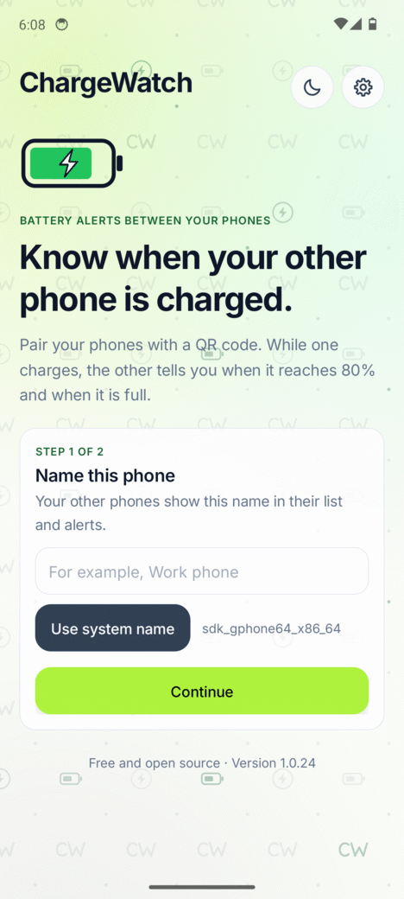
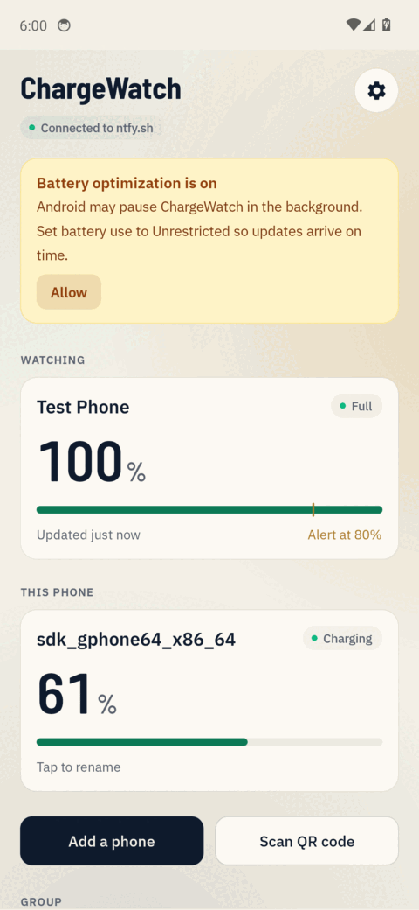
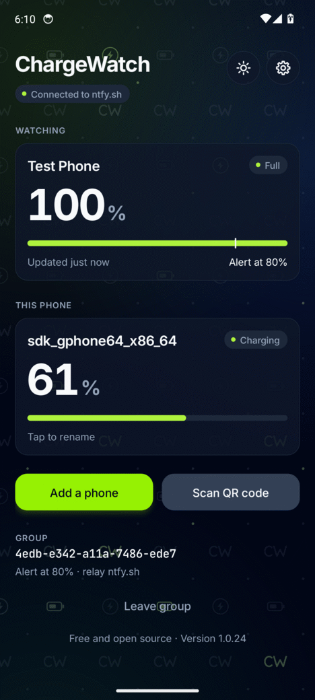
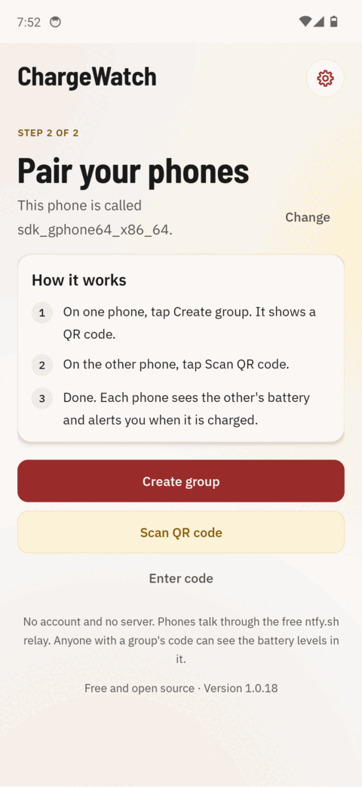
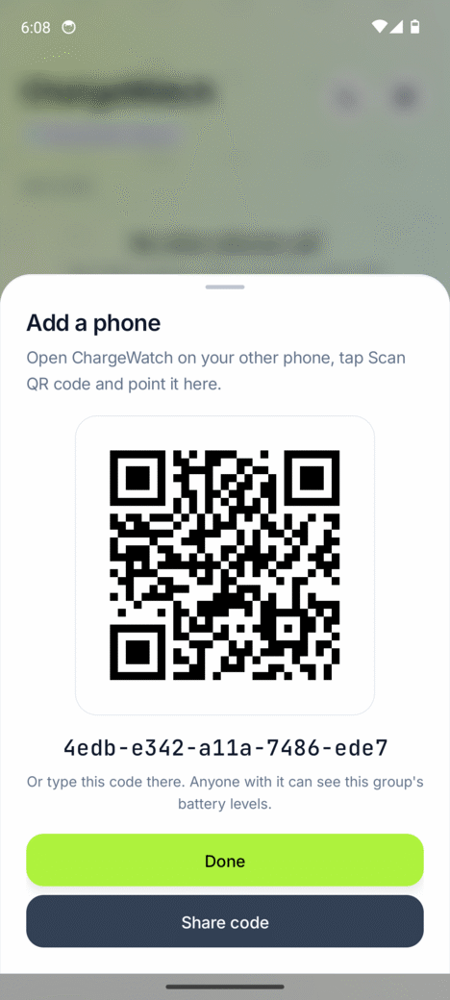
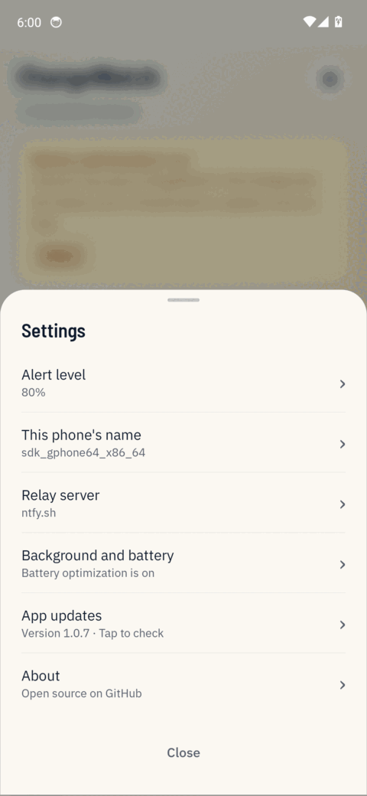
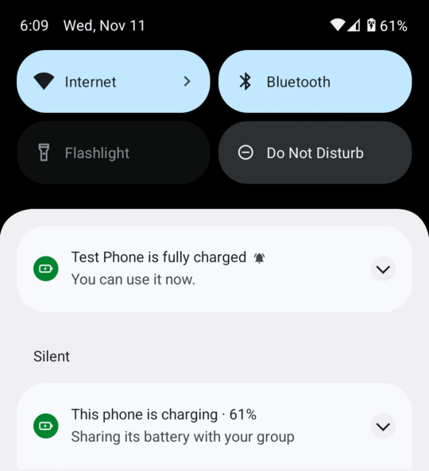

<p align="center">
  <picture>
    <source media="(prefers-color-scheme: dark)" srcset="docs/hero-dark.svg">
    
  </picture>
</p>

<p align="center">
  <b><a href="https://github.com/Sowan3k/chargewatch/releases/download/latest/ChargeWatch.apk">Download ChargeWatch.apk</a></b> · Android 8.0 or newer · under 500 KB · <a href="https://github.com/Sowan3k/chargewatch/releases/download/latest/ChargeWatch.zip">zip</a> if your browser blocks APKs
</p>

Your main phone is charging in another room and you are using a second phone. ChargeWatch tells the second phone when the first one hits 80% and when it is full.

It is a tiny Android app with no account and no backend. Phones pair by scanning a QR code and talk through the free [ntfy.sh](https://ntfy.sh) push relay.

<p align="center">
  
  
  
</p>
<p align="center">
  
  
  
</p>

Screenshots come from the automated test, which installs every build on an Android 14 emulator.

## What it does

The main screen lists every paired phone with its battery level, whether it is charging, and how long ago it last reported. When another phone in your group is charging you get two notifications:

1. "Pixel 7 is 80% charged" when it reaches your alert level (80% by default, you can change it).
2. "Pixel 7 is fully charged. You can use it now." when it reaches 100%.

<p align="center">
  
</p>

Each alert fires once per charge. A phone that hovers at 99/100% or sits at an 80% charge limit does not spam you.

## Install

1. Open the download link above on each phone and open the APK. Android asks you to allow installs from your browser or file manager. Allow it once. If the download sits at 100% and never finishes, get [ChargeWatch.zip](https://github.com/Sowan3k/chargewatch/releases/download/latest/ChargeWatch.zip) instead, open it in your Files app and tap the APK inside.
2. Open ChargeWatch, give the phone a name (or tap **Use system name**) and allow notifications.
3. Tap **Allow** on the battery banner and pick **Allow** (this sets battery usage to Unrestricted). Without it, Android may pause the app in the background. On Xiaomi phones, also turn on Autostart from Settings > Background and battery.

The APK is signed with a public debug key that lives in this repo, so each new build installs over the old one. Only install ChargeWatch from this repository's releases.

## Updates

ChargeWatch updates itself. It checks this repository's `latest` release when you open it (and once a day in the background), shows an **Update available** card, downloads the new APK, checks its SHA-256 against the release, and hands it to Android's installer. You confirm the install, and your group and settings stay. Android only accepts the update if it carries the same signature as the installed app. The first time, Android asks you to let ChargeWatch install apps. Settings > App updates checks on demand.

Releases only happen after the build passes its unit tests and the emulator test, so the in-app updater never offers an untested build.

## Pair your phones

1. On one phone, tap **Create group**. It shows a QR code.
2. On the other phone, tap **Scan QR code** and point the camera at it. The scanner comes from Google Play services, so the app needs no camera permission. If the scanner is not available, tap **Enter code** and type the code shown under the QR.
3. Both phones now appear on each other's screen. Add a third phone the same way with **Add a phone**.

To unpair, tap **Leave group**. The other phones remove this one from their list. Long press a phone that no longer exists to remove it by hand.

## Settings

The alert level can be Off, 50, 60, 70, 75, 80, 85, 90 or 95%. Each phone sets its own. Status notification chooses between showing the notification only while a phone is charging (the default) and always. You can also rename the phone (the default is the name set in Settings > About phone, or the model) and choose a relay server.

## Battery use and the notification

ChargeWatch is designed to cost almost nothing, and to stay out of sight, while nothing is charging.

While a phone is charging (this one, or another one heading for an alert), ChargeWatch runs live: a foreground service with a streaming connection, so alerts arrive within a second. Android requires a notification for that, so you see "Poco X8 is charging · 62%" (or "This phone is charging") until the charge is done, then it goes away. The live connection is the expensive part (ntfy sends a keepalive about every 45 seconds, and each one wakes the radio), which is why it only runs during a charge, usually an hour or two, or while the app is open.

The rest of the time nothing runs: no service, no notification, no connection. Android's JobScheduler runs a short check about every 15 minutes, only when there is a network, batched with other apps' work and held during Doze. A second job runs the moment this phone is plugged in. A check fetches what is new, posts any alert, sends this phone's level if it is due, and goes live if another phone has started charging. Alerts still fire for transitions a check finds up to 20 minutes late, and never twice.

If you prefer the notification all the time, Settings > Status notification > Always keeps the service running, in low-power mode while nothing charges (checks every 15 minutes and when you turn the screen on).

Going live from a background check needs battery use set to Unrestricted. Without it, the checks still deliver alerts and send the level, just less often.

Other details: battery changes are only sent in 1% steps while charging above 50% (5% steps otherwise). Heartbeats go out every 30 minutes on power and every 60 minutes on battery, and each report says which, so other phones know when to call it offline. All network work runs on one thread under a short wakelock. With no network, the app waits for the connection to come back instead of retrying on a timer. The notification is only updated when its text changes.

## Keeping it running in the background

ChargeWatch runs a foreground service with a notification while a phone is charging, and background jobs the rest of the time. Both survive a reboot and an app update. Most problems come from aggressive battery savers, so if updates stop arriving check these:

- Battery usage for ChargeWatch is set to Unrestricted (Settings, Apps, ChargeWatch, Battery).
- On Samsung, ChargeWatch is not in Sleeping apps or Deep sleeping apps.
- On Xiaomi, Oppo, Vivo, OnePlus and Huawei, Autostart is on and the app is locked in Recents.

[dontkillmyapp.com](https://dontkillmyapp.com) has steps for every brand.

## How it works

A group is 80 random bits. The QR code holds `chargewatch:<group id>` and the ntfy topic is `chargewatch-<group id>`. Each phone has a random device id. When its battery changes it posts a small JSON message to the topic:

```json
{"v":1,"id":"5f2c9a1be07d4c13","name":"Pixel 7","level":82,"charging":true,"hb":1800}
```

Every phone also reads the same topic: a streaming connection in live mode, and one-shot checks (`/json?poll=1&since=<last id>`) in low-power mode (see Battery use). The first read uses `since=12h`, so a phone learns the current state of every other phone from ntfy's 12-hour cache. It keeps a map of devices and fires an alert only on a transition (previous level below the mark, new level at or above it), only for messages under 20 minutes old, and never for its own messages. Old and duplicate messages are ignored, so replaying the backlog never repeats an alert.

To stay well under the public relay's limits, a phone sends every 1% change while charging above 50%, every 5% otherwise, and a heartbeat when nothing changes (every 30 minutes on power, 60 on battery; `hb` says which). The heartbeat is what lets the list say "Last seen 3 h ago" for a phone that has gone quiet. A normal day is roughly 80 to 110 messages per phone.

## Privacy

ChargeWatch has no server, so it cannot count its users, and it does not try. The app shows two public numbers anyone can check on GitHub instead: total downloads from the releases and the repository's stars. A scheduled workflow (`.github/workflows/stats.yml`) copies them into the release's `version.json` every six hours. They stay hidden in the app until they pass 10.

There is no ChargeWatch server and no account. The messages carry only a random id, the phone name, the battery level and the charging state. Anyone who has your group's QR code or code can read them, and so can the relay operator. If that matters to you, run your own relay.

The QR scanner comes from Google Play services through Google's ML Kit library, which may send anonymous usage statistics about the scanner to Google. The app asks for no camera, location or contacts permission.

## Self-hosted relay

ChargeWatch works with any [ntfy server](https://docs.ntfy.sh/install/). Set it under Settings, Relay server before you create the group. The server URL is then part of the QR code (`chargewatch:<group id>@https://ntfy.example.com`), so the other phones pick it up when they scan. The server must allow anonymous read and write on `chargewatch-*` topics and should keep a message cache of at least 12 hours.

## Build from source

You need JDK 17 and the Android SDK (platform 34).

```sh
./gradlew testReleaseUnitTest assembleRelease
# APK: app/build/outputs/apk/release/app-release.apk
```

The project uses Gradle 8.9, Android Gradle Plugin 8.5.2 and Kotlin 1.9.24. The UI is plain `android.app.Activity` built in code with no AndroidX UI libraries. A small design system in `Ui.kt` gives it a warm claret theme (off-white paper, claret actions, amber for charging, with a warm stone dark mode), Barlow Semi Condensed and IBM Plex type (bundled, SIL Open Font License), cards, status pills and bottom sheets. `tools/icon_gen.py` draws the icon set (launcher, monochrome, status bar, settings) and `tools/hero_gen.py` the animated banner at the top of this page. The only dependencies are ZXing core (to draw the QR code) and the Google code scanner (to read it). Release builds use R8 and resource shrinking.

Every push to `main` runs the GitHub Actions workflow in `.github/workflows/build.yml`. It runs the unit tests, builds the release APK, fails if the APK is over 5 MB, and uploads `ChargeWatch.apk` to the [`latest` release](https://github.com/Sowan3k/chargewatch/releases/tag/latest). A second job installs that APK on an Android 14 emulator and drives it end to end (`.github/scripts/emulator_test.py`): it creates a group, checks that battery changes reach ntfy.sh, plays a second phone to trigger both alerts, restarts the app to make sure alerts do not repeat, and leaves the group.

## License

MIT. See [LICENSE](LICENSE).
